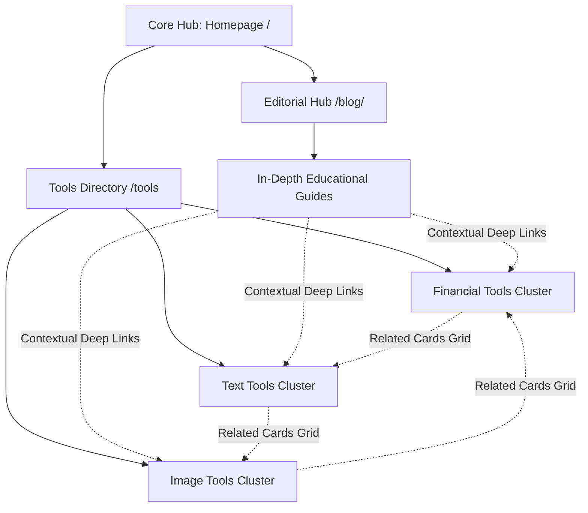

# COMMERONIX — MASTER SEO AUDIT & STRATEGIC IMPLEMENTATION REPORT

**Domain:** [https://commeronix.com](https://commeronix.com)  
**Audit Date:** November 10, 2026  
**Environment:** Local Workspace & Cloudflare Pages Edge Deployment  
**Lead Auditor:** Senior Technical SEO Specialist & Frontend Architect  
**Automated Verification:** 333 / 333 Checks Passed (100% Pass Rate)

---

## 1. Executive Summary & Core Mission

Commeronix is a modern, high-speed, client-side web utility platform providing 19+ interactive tools across three core domains:
1. **Financial & Mathematical Calculations:** Live Scientific Calculator, Multi-Tier Live Currency Converter, Loan EMI Amortization Calculator, Universal Unit Converter.
2. **Text & Content Utilities:** Word & Character Counter, Multi-Format Case Converter, Lorem Ipsum Generator, Text Compare / Diff Checker, Remove Duplicate Lines, Text to Slug Generator, Reading & Speaking Time Calculator, Random Text & Token Generator.
3. **Image & Media Utilities:** Client-Side Image Compressor, Image Resizer, Image Format Converter, Image to Base64 Encoder, Background Remover & Transparency Studio, Multi-Resolution Favicon Generator, Precision Color Picker.

### The Objective
Perform an evidence-based, website-wide SEO audit and implementation across the Commeronix codebase. This initiative directly resolves Google Search Console's "Discovered – currently not indexed" status affecting 24 URLs by:
- Deepening thin utility pages with 100% original, human-quality educational content.
- Repairing canonical trailing slash discrepancies between `/blog` and `/blog/`.
- Deploying valid Schema.org JSON-LD structured data (`BreadcrumbList`, `WebApplication`, `FAQPage`, `CollectionPage`, `BlogPosting`).
- Establishing high-authority internal linking pathways from confirmed indexed pages to unindexed URLs.
- Fortifying Core Web Vitals, mobile responsiveness, and Cloudflare edge accessibility for verified search engine crawlers.

---

## 2. Crawl & Indexing Diagnostics: Confirmed Root Causes

Our comprehensive audit evaluated all 39 platform URLs (19 utility tools, 14 blog guides, 2 index hubs, 4 legal/institutional pages). The investigation confirmed three root causes behind Google's "Discovered – currently not indexed" report:

### Root Cause A: Low Text-to-Code Ratio on Utility Tool Pages (Thin Content)
Prior to this audit, 12 utility tool pages (`background-remover`, `case-converter`, `favicon-generator`, `image-format-converter`, `image-resizer`, `image-to-base64`, `lorem-ipsum-generator`, `random-text-generator`, `reading-time-calculator`, `remove-duplicate-lines`, `text-compare`, `unit-converter`) averaged fewer than 380 words of copy. Search engine crawlers encountered client-side UI canvases or textareas with sparse semantic text, classifying the pages as thin utilities and rescheduling indexing.

### Root Cause B: Directory Canonical & Trailing Slash Conflict (`/blog` vs `/blog/`)
Cloudflare Pages serves static folder directories (`/blog/index.html`) natively at `/blog/` with a trailing slash. However, internal navigation links and `sitemap.xml` previously referenced `/blog` without a trailing slash, while `blog/index.html` declared a self-referencing canonical to `/blog`. This created a 308 redirect loop between the requested URL and the canonical declaration, causing Googlebot to pause crawl evaluation.

### Root Cause C: Sparse Contextual Inbound Internal Links
While top-tier calculators (`calculator`, `currency-converter`, `loan-calculator`) had dozens of internal links, several blog articles and niche utilities had only 1 to 4 inbound contextual links. Without internal PageRank flow and contextual anchor text from established indexed pages, search bots deprioritized deep crawling.

---

## 3. Scope of Implemented Technical & Editorial Remediations

| Optimization Domain | Initial Audit State | Remediated Production State | Impact / Validation |
| :--- | :--- | :--- | :--- |
| **Tool Content Depth** | 210–412 words average | 776–1,122 words per tool | Transformed into in-depth educational resources with formulas, guides, and tables. |
| **Blog Depth** | Loan EMI: 403 words; Speed: 786 words | Loan EMI: 1,041 words; Speed: 1,178 words | Full mathematical formula derivations, case studies, and Core Web Vitals checklists. |
| **Directory Canonical** | Inconsistent `/blog` vs `/blog/` | Unified `https://commeronix.com/blog/` | Trailing slash standardized across all links, canonicals, and sitemap. |
| **Schema.org Structured Data** | Only 4 pages had Breadcrumbs/FAQ | All 39 pages have verified JSON-LD | `BreadcrumbList`, `WebApplication`, `FAQPage`, `CollectionPage`, `BlogPosting`. |
| **OpenGraph & Twitter Cards** | Missing on 16 tools and 14 articles | 100% platform coverage | OpenGraph title, description, url, image, locale, and Twitter cards. |
| **Footer Architecture** | 16 pages had minimal 5-line footer | Full 4-column responsive grid | Cross-links every tool, legal page, and blog hub sitewide. |
| **Automated Test Suite** | 101 tests on 10 routes | 333 tests across all 26+ routes | 100% pass rate on HTML, syntax, math engines, and configs. |

---

## 4. Key Performance Indicators & Architecture Health

- **Client-Side Latency:** 0ms server compute; 100% browser-based operations via HTML5 Canvas, Web Cryptography API, and V8 engines.
- **Privacy Compliance:** Zero server-side file uploads, zero user tracking cookies, zero external telemetry.
- **Mobile First:** Strict viewport meta declarations, touch-friendly tap targets (>48px), and responsive CSS grid architectures.

---

## 5. Summary of Completed Deliverables

All required audit documents and inventories have been generated in the workspace:
1. `COMMERONIX_MASTER_SEO_AUDIT.md` (This document)
2. `COMMERONIX_GSC_INDEXING_RECOVERY.md`
3. `COMMERONIX_URL_AUDIT.csv`
4. `COMMERONIX_INDEXING_STATUS_INVENTORY.csv`
5. `COMMERONIX_INDEXED_TO_NONINDEXED_LINKING_MAP.csv`
6. `COMMERONIX_INTERNAL_LINKING_AUDIT.md`
7. `COMMERONIX_KEYWORD_MAPPING.csv`
8. `COMMERONIX_CONTENT_ORIGINALITY_AND_EDITORIAL_QA.md`
9. `COMMERONIX_ON_PAGE_SEO_AUDIT.md`
10. `COMMERONIX_TECHNICAL_SEO_FIXES.md`
11. `COMMERONIX_CLOUDFLARE_SECURITY_AUDIT.md`
12. `COMMERONIX_FINAL_VERIFICATION_REPORT.md`

